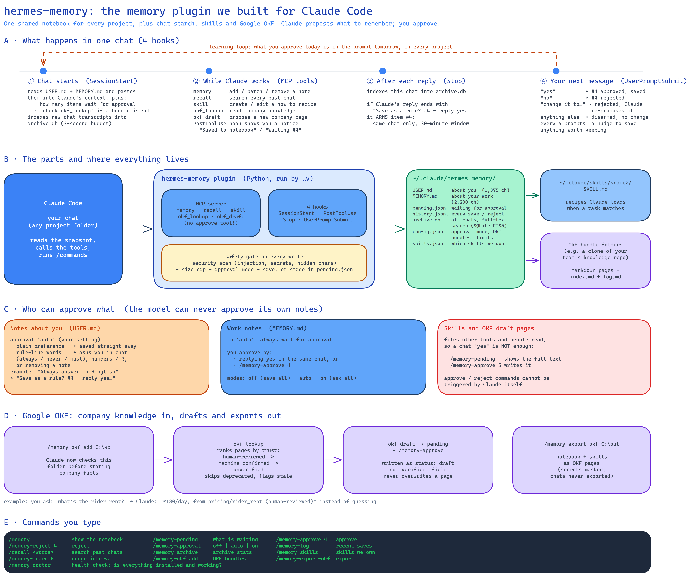

# hermes-memory

Persistent memory for Claude Code, modelled on the memory system of
[Hermes Agent](https://github.com/NousResearch/hermes-agent). This is an independent project; it is
not affiliated with Nous Research.

Claude Code keeps memory per project folder, so a preference learned in one folder is invisible in the
next. This plugin adds a **shared notebook** that loads into every session in every project, next to
Claude Code's own per-project memory (which keeps working as before).

## How it works



_Editable source: [docs/architecture.excalidraw](docs/architecture.excalidraw) (open it at excalidraw.com)._

| Piece | What it does |
|---|---|
| `USER.md` | Notes about you: preferences, communication style. Cap 1,375 chars. |
| `MEMORY.md` | Lessons about your work that apply across projects. Cap 2,200 chars. |
| SessionStart hook | Injects both files into the session as a frozen snapshot, with a usage header (`[67% — 1,474/2,200 chars]`). Writes made during a session show up in the next one. |
| `memory` MCP tool | Claude adds, patches or removes notes. Over the cap → refused; Claude must merge or delete first. |
| Security scan | Blocks prompt-injection phrases, API keys / passwords, exfiltration commands and invisible unicode. |
| Approval queue | Notes can wait for your yes/no before they are saved (see below). |
| Chat archive | Every chat is copied into `archive.db` (SQLite full-text search) after each turn and at session end, with secrets redacted. Claude Code deletes transcripts after 30 days; the archive keeps them. |
| `recall` MCP tool | Claude searches past chats ("what did we decide about X?") and can scroll around a hit. No LLM cost. |
| `skill` MCP tool | Claude saves reusable multi-step procedures as Claude Code skills in `~/.claude/skills/`. It only edits or deletes skills it created and that you have not edited since; deleted ones go to `skills-archive/`. Skills are approved only with `/memory-approve`, after `/memory-pending` shows their full text. |
| In-chat approval | When a note needs approval, Claude ends its reply with one question naming it (`#3`). Your **next message in that same chat, within 30 minutes**, answers it: `yes` saves, `no` discards, `yes, but …` / `change …` sends it back for a rewrite, anything else leaves it waiting in `/memory-pending`. The question only counts if it really is the last line of Claude's reply. |
| Learning check | Every few prompts Claude is reminded to save durable preferences, corrections and procedures. |

Files live in `~/.claude/hermes-memory/` (override with `HERMES_MEMORY_HOME`).

**Privacy:** `archive.db` holds the text of your chats (user and assistant messages, not tool output), on your
machine only. Credential-shaped strings are redacted before storage, but anything else you paste stays in it.
Delete the file to wipe the archive.

### Approval modes

| Mode | `user` notes | `memory` notes |
|---|---|---|
| `off` | saved immediately | saved immediately |
| `auto` (default) | saved immediately, unless they read like a rule (always / never / must) or contain numbers or amounts | wait for approval |
| `on` | wait for approval | wait for approval |

The plugin gives Claude **no tool to approve its own notes**: the `memory` tool can only stage them, and
the approve / reject / approval commands are marked `disable-model-invocation`, so only you can run them.

**Limit:** Claude Code still gives Claude general Bash and file-editing tools. In principle it could run
the CLI or edit `~/.claude/hermes-memory/` directly. To close that gap, add deny rules to your
`~/.claude/settings.json`:

```json
{
  "permissions": {
    "deny": [
      "Edit(~/.claude/hermes-memory/**)",
      "Write(~/.claude/hermes-memory/**)",
      "Bash(*hermes-memory approve*)",
      "Bash(*hermes-memory reject*)",
      "Bash(*hermes-memory approval*)"
    ]
  }
}
```

In-chat approval is decided from **your typed reply**, read by a prompt hook, never from anything Claude writes. One residual risk: a bare `yes` or `ok` answers the pending question even if you meant it for something else Claude asked in the same reply. That is why skills, which run as instructions in every project, can only be approved with `/memory-approve`.

## Company knowledge: Google OKF

[Open Knowledge Format](https://github.com/GoogleCloudPlatform/open-knowledge-format) (OKF, v0.2) is a folder
of markdown pages, one concept per page, with a small YAML header (`type`, `title`, `tags`, `verified`,
`status`, `stale_after`, ...). Your notebook is personal; an OKF bundle is shared company knowledge.

| Piece | What it does |
|---|---|
| `/memory-okf add <folder>` | Point the plugin at an OKF bundle (for example a git clone of your team's knowledge repo). |
| `okf_lookup` MCP tool | Claude searches the bundles before stating company facts. Results carry the spec's trust tier (`human-reviewed` > `machine-confirmed` > `unverified`), `status` and staleness; deprecated pages are skipped. |
| `okf_draft` MCP tool | Claude proposes a **new** page for a fact it learned. It is written only after `/memory-approve`, always as `status: draft` with `generated.by: hermes-memory/<version>` and no `verified` field, and logged in `log.md`. Existing pages are never overwritten. |
| `/memory-export-okf <folder>` | Writes `memory/user-profile.md`, `memory/work-notes.md` and one `skills/<name>.md` (type `Playbook`) per skill, plus `index.md` files and `log.md`. Secrets are redacted on the way out; a re-export replaces only the files it wrote before. The chat archive is never exported. |

Notes:
- Give **full** folder paths (`C:\Users\you\kb`, or `~/kb`). Slash commands run inside the plugin folder, so relative paths are refused.
- Paths containing an apostrophe (`O'Brien`) are not supported by the two OKF slash commands.
- Trust tiers are advisory: a page writes its own `verified` field. Lookups skip dot folders (`.git`), links leading outside the bundle and pages over 256 KB, and read at most 5,000 pages per bundle.

## Commands

| Command | What it does |
|---|---|
| `/memory` | Show both notebooks and how full they are |
| `/memory-pending` | List notes waiting for approval |
| `/memory-approve <id\|all>` | Save a waiting note |
| `/memory-reject <id\|all>` | Throw a waiting note away |
| `/memory-approval [off\|auto\|on]` | Show or change the approval mode |
| `/memory-log [n]` | Recent activity: saved / waiting / approved / rejected / blocked, with project and reason |
| `/memory-doctor` | Health check: folder, config, size limits, approval queue, MCP SDK, chat archive |
| `/recall <words>` | Search all your past Claude Code chats, across every project |
| `/memory-archive` | Copy every existing transcript into the archive (safe to re-run) |
| `/memory-skills` | List the skills hermes-memory has created |
| `/memory-learn [n]` | How often Claude is reminded to save what it learned (default every 6 prompts; 0 = off) |
| `/memory-okf [add\|remove <folder>]` | List, add or remove the OKF bundles Claude can look up |
| `/memory-export-okf <folder>` | Export your notebook and skills as an OKF v0.2 bundle |

Every memory change also shows a one-line notice in the chat, for example `💾 Memory saved (52/1,375)` or
`⏳ Memory waiting for approval #3 — /memory-pending to review`.

## Install

Requires [uv](https://docs.astral.sh/uv/) on your PATH.

```
/plugin marketplace add sid13791/claude-hermes-memory
/plugin install hermes-memory@claude-hermes-memory
```

Restart Claude Code. The first session can take up to a minute while uv creates the environment and
installs the MCP SDK; later sessions start in well under a second. If the notebook does not appear in the
first session, start a new one.

## Develop

```bash
uv sync
uv run pytest --cov=hermes_memory
```

## Roadmap

1. **Shared notebook**: done in 0.1.x.
2. **Chat archive + `recall`**: done in 0.2.0.
3. **Learning loop, in-chat approval, skills**: done in 0.3.0.
4. **Google OKF lookup, drafts and export**: done in 0.5.0.

## License

MIT
